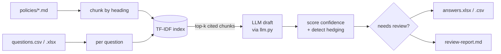

# questionnaire-autopilot

**Auto-draft answers to security & vendor questionnaires (SOC 2 / ISO 27001 / CAIQ) straight from your own policy docs, with citations, a confidence score, and a needs-review flag.**

> **This is an AI drafting aid, not a compliance guarantee.** Every answer is a
> machine-generated draft that a qualified person must review, correct, and
> approve before it is sent. Nothing here attests to compliance.

## The problem

Security and GRC teams get the same long questionnaires over and over, and each
answer is already written down somewhere in their policies. Copy-pasting 150
answers by hand is slow, inconsistent, and easy to get wrong. The facts exist;
the retrieval is the chore.

## What it does

Point it at a questions file and your `policies/` folder. For each question it:

1) retrieves the most relevant policy sections with a deterministic TF-IDF search (fully offline),
2) asks an LLM to draft an answer using **only** those excerpts,
3) attaches the **cited policy + section**, a **confidence score** (retrieval strength, reduced when the model hedges), and a **needs-review flag**,
4) writes a reviewer-ready `answers.xlsx` / `answers.csv` and a `review-report.md`.

Questions with no matching policy (e.g. "do you run penetration tests?" when you
have no pen-test policy) are automatically flagged low-confidence so a human
knows exactly where to look.

## Architecture



## Install

```bash
# install as a command-line tool (recommended)
pipx install git+https://github.com/aminafara123/questionnaire-autopilot
questionnaire-autopilot --questions input/questions.csv --policies policies --out output
```

Or install into the current environment from a clone with `pip install .`. The `make` targets and `python autopilot.py` path below still work for local development.

## Quickstart

```bash
pip install -r requirements.txt          # 1) deps (scikit-learn, openpyxl)
cp .env.example .env                      # 2) optional: point at your LLM
python autopilot.py                       # 3) draft from the bundled samples
# outputs land in output/: answers.xlsx, answers.csv, review-report.md
```

`make install` / `make test` / `make run` wrap the same steps. By default the LLM
calls a local [ollama](https://ollama.com) server (`http://127.0.0.1:11434/v1`);
set `LLM_BASE_URL` / `LLM_MODEL` / `LLM_API_KEY` to use any OpenAI-compatible
endpoint. If the model is unreachable, the tool still runs: it emits the cited
policy excerpt for manual drafting and flags the row for review.

Run against your own data:

```bash
python autopilot.py --questions path/to/questions.xlsx --policies path/to/policies --out output
```

## Sample run

Input (`input/questions.csv`):

| ID  | Framework | Question |
|-----|-----------|----------|
| Q01 | CAIQ      | Do you enforce multi-factor authentication for access to production systems? |
| Q14 | SOC2      | Do you conduct criminal background checks on employees before hire? |

Output (`output/answers.csv`, columns `Question, Draft Answer, Cited Source, Confidence, Needs Review`):

| Question | Draft Answer (excerpt) | Cited Source | Confidence | Needs Review |
|----------|------------------------|--------------|-----------:|:------------:|
| Do you enforce MFA for production systems? | Yes. MFA is enforced for all access to production systems using TOTP or FIDO2 keys... | access-control.md > Authentication and Multi-Factor Authentication | 1.00 | No |
| Do you conduct criminal background checks before hire? | The provided policies do not clearly address this... | access-control.md > Purpose and Scope | 0.29 | **Yes** |

`review-report.md` then summarises the batch:

```
- Total questions: 15
- High confidence (>= 0.70): 11
- Medium confidence (0.40-0.69): 2
- Low confidence (< 0.40): 2
- Flagged needs review: 3
```

## Demo


## How it works

- **Chunking** — each policy `.md` is split by markdown heading, so a citation is a real section ("encryption.md > Key Management and Rotation"), not a whole file.
- **Retrieval** — scikit-learn `TfidfVectorizer` + cosine similarity. Deterministic, no network, no embeddings cost. (An embeddings endpoint is an easy upgrade via the same `llm.py`.)
- **Confidence** — derived from the top retrieval cosine score and reduced when the draft hedges ("not specified", "may", "do not clearly address"). A question whose best match is below a floor is treated as **no relevant policy found** and scored 0.
- **Needs review** — set when confidence is low, the model hedged, the model was unavailable, or no policy matched.
- **LLM boundary** — all model calls go through one thin module (`llm.py`); the deterministic core is fully testable offline with the LLM mocked.

## Tech stack

Python 3, scikit-learn (TF-IDF retrieval), openpyxl (xlsx I/O), stdlib `urllib`
for the OpenAI-compatible LLM call, pytest. No API key required for the offline
retrieval and tests.

## Tests

```bash
pytest -q      # offline, LLM mocked: retrieval ranking, scoring, needs-review, file generation
```

## License

MIT (c) 2026 Al Amin Bashir Afara. See [LICENSE](LICENSE).
